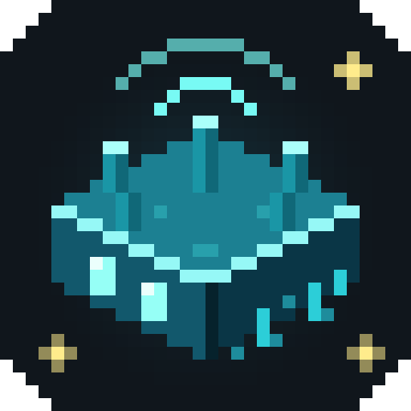

<p align="center"></p>

# Sculkwire

**Get a notification on your phone, Discord or any webhook when something happens in Minecraft.**
Someone says your name, night falls, you are low on health while AFK, you get kicked, a friend
comes online: you decide what counts and where it goes.

Sculkwire is a client-side Fabric mod for Minecraft **26.3**. It works on any server, including
singleplayer, and sends nothing to the game server.

## Features

- **Notifiers**: set up as many endpoints as you like.
  - **ntfy**: push notifications to your phone through [ntfy.sh](https://ntfy.sh) or your own ntfy server.
  - **Discord webhook**: posts to a channel, as an embed or plain text.
  - **Webhook**: any HTTP endpoint (Slack, Home Assistant, n8n, your own server) with a body you design.
  - **Telegram**, **Gotify**, **Pushover**, a **log file**, and **in-game** (toast, chat, action bar or title).
- **Events**: pick a trigger, add conditions, choose which notifiers get it.
  - Something happens: a chat message (contains, regex, mentions you, from your friends list), you die,
    take damage, use a totem, change dimension, level up, an item breaks, a title or boss bar appears,
    a player joins the server or comes into view, you are disconnected, a sound plays, and more.
  - A condition becomes true: anything the game tracks (about 100 values) compared with a number, text
    or another value. Health, hunger, time of day, weather, dimension, biome, mobs nearby, ping, TPS,
    held item durability, free inventory slots, AFK time, scoreboard lines, ...
  - A value changes, or a schedule (every N seconds, at a world time, at a real time).
- **No spam**: notifications fire when a condition *starts* being true, with optional re-arm thresholds,
  "must hold for N seconds", cooldowns, hourly limits, once per session, quiet hours and a global mute.
  Conditions that are already true when you join do not fire.
- **Variables**: use `{player.name}`, `{msg.text}`, `{player.health|hearts}` or any tracked value in
  messages and conditions, plus your own variables (for example a `friends` list).
- **Editor in game**: `/sw` or a key binding opens the editor. It has a live inspector of every value, a
  preview of your message, and a delivery history. Everything is also plain JSON in `config/sculkwire/`.
- **19 presets** to start from, and import/export to share events (never with your secrets).

## Getting started

1. Install [Fabric Loader](https://fabricmc.net/use/) and [Fabric API](https://modrinth.com/mod/fabric-api) for
   Minecraft 26.3, then put Sculkwire in your `mods` folder.
2. On your phone, install the ntfy app and subscribe to a topic with a long random name.
3. In game, run `/sw` (or bind *Open Sculkwire* in Controls).
   1. Go to **Notifiers → + Add notifier → ntfy**, press **Random topic** (or type your topic), then **Save & test**.
   2. Go to **Events → + Preset**, pick **Mentioned in chat** or **Low health**, and **Save**.

That's it. To see why an event did or did not send, look at its line on the Events tab ("last: …") or run
`/sw status <event>`.

### Without the editor

```
/sw notifier add ntfy phone
/sw notifier set phone topic my_long_random_topic
/sw test phone
/sw preset mentioned phone
```

## How events work

An event has a **trigger**, optional **conditions** ("Only if"), a **message**, and the **notifiers** to
send to.

| Trigger | Fires when | Example |
|---|---|---|
| Something happens | the game event happens and its filters match | `chat.message` with *Match: mentions_me* |
| A condition becomes true | the condition goes from false to true (or on exit, or repeatedly while true) | `player.health < 6`, re-arm at `≥ 10` |
| A value changes | the value differs from before (optionally from/to, minimum change) | `world.weather` to `thunder` |
| On a schedule | every N seconds, at a world time, or at a real time | at world time `13000` (dusk) |

**Values in messages:** `{name}` inserts a value, and `{name|filter}` formats it. Filters:

- `hearts`, `int`, `round`, `fixed:2`, `percent`
- `clock` (world ticks to HH:MM), `duration` (seconds to 1h 2m), `date:'HH:mm'`
- `pretty` (`minecraft:the_nether` becomes `The Nether`)
- `upper`, `lower`, `title`, `trim`, `truncate:50`, `replace:'a':'b'`
- `default:'none'`, `join:', '`, `count`, `first`, `last`, `yesno`, `coords`, `strip`
- `add:1`, `sub:1`, `mul:2`, `div:2`, `abs`

Signals with parameters are written like `{nearby.hostiles(radius=8)}`. Values from chat are escaped
for where they go, so a quote in someone's message cannot break your webhook JSON. On Discord, mentions
inside messages never ping anyone: only the ids in the notifier's *Mention* field do.

See [docs/COOKBOOK.md](docs/COOKBOOK.md) for ready-to-use recipes.

## Commands

Everything is under `/sculkwire`, or `/sw` for short. All commands run on your client only.

| Command | What it does |
|---|---|
| `/sw` | Open the editor |
| `/sw list [rules\|notifiers\|presets\|variables]` | Show what you have, with status |
| `/sw test <notifier>` | Send a test notification |
| `/sw fire <event>` | Send an event's message now (marked as test) |
| `/sw status <event>` | Problems and the last outcome |
| `/sw enable\|disable <event>` | Turn an event on or off |
| `/sw mute [minutes]`, `/sw unmute` | Mute everything for a while |
| `/sw signal <id> [k=v]`, `/sw signals [filter]` | Show a live value, list values |
| `/sw var set\|add\|remove\|clear <name> [value]` | Change your variables (`add`/`remove` for lists) |
| `/sw preset <id> [notifier ...]` | Add a preset event |
| `/sw notifier add <type> <id>` | Add a notifier |
| `/sw notifier set <id> <key> <value>` | Change a notifier setting (secrets go to secrets.json) |
| `/sw notifier remove <id>` | Remove a notifier |
| `/sw emit <name> [text]` | Post a `custom` event (for testing, or from other mods) |
| `/sw history [n]`, `/sw reload`, `/sw debug events\|perf` | History, re-read files, debugging |

## Files

`config/sculkwire/` holds:

- `config.json`: events, notifiers (without secrets), variables and settings. Safe to edit by hand; run
  `/sw reload` afterwards. A file that cannot be read is renamed to `config.json.broken-<time>` and never
  overwritten silently.
- `secrets.json`: webhook URLs, tokens and passwords, as **plain text**. Values may refer to environment
  variables as `${env:NAME}`. Never share this file.
- `history.jsonl`: recent deliveries (capped at about 1 MB). Tokens are removed from error messages.
- `logs/`: output of the log-file notifier, if you use one.

## Privacy and safety

- Notifications can contain chat text, coordinates and player names. They leave your computer when you
  send them to ntfy, Discord or a webhook. The in-game and log-file notifiers keep everything local.
- On the public ntfy.sh, anyone who knows a topic can read it. Use a long random topic (the editor makes
  one) or an access token.
- Imported events arrive disabled, and exports never include notifier settings or secrets.
- Sculkwire only reads what your client already knows and sends no packets to the server. Some servers
  have rules about client mods, so check yours.

## For mod developers

Other mods can add signals, events and notifier types through the `sculkwire` entrypoint
(`dev.sculkwire.api.SculkwirePlugin`), and post events with `SculkwireApi.emit(...)`. Ids must be
namespaced, e.g. `mymod:mana`. The API is experimental until 1.0.

## Building

You need JDK 25.

```bash
./gradlew build
```

The jar ends up in `build/libs/`.

- **Tests:** the core (engine, templates, notifiers, config) does not use Minecraft classes, so
  `./gradlew test` runs plain JUnit tests, including against a loopback HTTP server.
- **Local test server:** `./gradlew runServer --args=nogui` with RCON enabled, plus
  `tools/capture_server.py` as a stand-in for ntfy, Discord and webhooks, and `tools/rcon.py` to script
  game situations.
- **UI screenshots:** `./gradlew runClient -Pdevshots` opens each editor screen after joining and saves a
  screenshot of it.

## License

MIT
